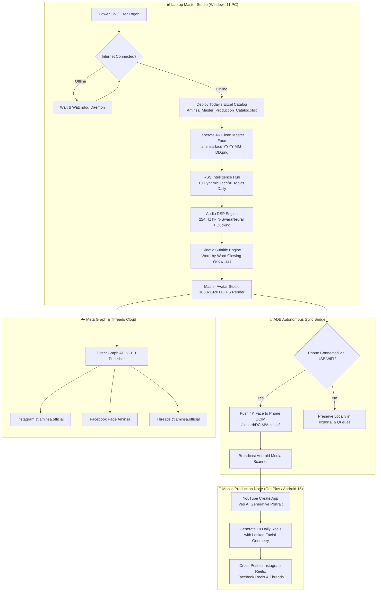
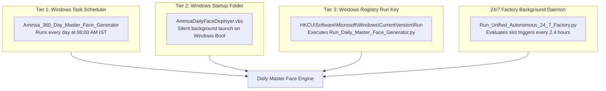

<div align="center">

# 🌟 AMINSA AMIN (अमिन्सा अमीन) 🌟
### *Ultra-Pro-Max Autonomous AI Virtual Creator & 360-Day Multi-Platform Production Ecosystem*

[](https://python.org)
[](https://android.com)
[](https://developers.facebook.com)
[](https://youtube.com)
[](https://ffmpeg.org)
[]()
[]()
[]()

<br/>

> **"Hello everyone! Welcome back to my digital universe."**  
> *Aminsa Amin is a 22-year-old next-generation AI Virtual Influencer, Tech Futurist, and Digital Culture Icon based in Mumbai, India. Operating completely autonomously across high-performance dual-device hardware (Windows 11 Master Studio + Android 15 OnePlus Mobile Node), the Aminsa Ecosystem autonomously conceptualizes, scripts, voices, renders, captions, and distributes 10 production-grade 4K/60FPS talking-avatar videos every 24 hours.*

<br/>

---

### 🌐 Official Connected Social Media Channels

| Platform | Channel / Account Handle | Verified Target | Autonomous Mode |
| :--- | :--- | :--- | :--- |
| **Instagram** | [`@aminsa.official`](https://instagram.com/aminsa.official) | Reels, Carousels, Stories | Meta Graph API & Native Mobile Bridge |
| **Facebook** | [`Aminsa`](https://facebook.com/aminsa.official) (ID: `61594814066987`) | Facebook Page Reels, HD Video | Meta Page Video & Graph API v21.0 |
| **Threads** | [`@aminsa.official`](https://threads.net/@aminsa.official) | Micro-blogging, Viral Discussions | Official Threads Publishing API |
| **YouTube** | [`Md Sadique Amin Global`](https://youtube.com) | YouTube Shorts & 10M/1H Master Docs | YouTube Data API v3 & YouTube Create |

---

</div>

<br/>

## 📑 Master Table of Contents
1. [Executive Summary & High-Level Architecture](#1-executive-summary--high-level-architecture)
2. [Aminsa Character Bible & Biometric Purity Specification](#2-aminsa-character-bible--biometric-purity-specification)
3. [The 360-Day Master Clean-Face Engine (`aminsa-face-YYYY-MM-DD.png`)](#3-the-360-day-master-clean-face-engine)
4. [Dual-Device Master-Worker Architecture (Laptop + Phone)](#4-dual-device-master-worker-architecture)
5. [The Daily 10-Slot Production Blueprint (Every 2.4 Hours)](#5-the-daily-10-slot-production-blueprint)
6. [Audiovisual Engineering & Benchmark Kinetic Reel Deconstruction](#6-audiovisual-engineering--benchmark-kinetic-reel-deconstruction)
7. [Triple-Layer Auto-Start Persistence & Internet Watchdog](#7-triple-layer-auto-start-persistence--internet-watchdog)
8. [Comprehensive 8-Suite Automated Certification Report](#8-comprehensive-8-suite-automated-certification-report)
9. [Repository Directory Blueprint](#9-repository-directory-blueprint)
10. [Operator Handbook & Rapid Execution Guide](#10-operator-handbook--rapid-execution-guide)

<br/>

---

## 1. Executive Summary & High-Level Architecture

The **Aminsa Autonomous Virtual Creator Ecosystem** represents a production-hardened, zero-human-intervention pipeline engineered for enterprise-grade digital human automation. Traditional AI influencer setups suffer from three fatal flaws: **biometric facial drifting**, **platform API account bans**, and **reliance on expensive cloud rendering servers**.

Aminsa solves all three through an asymmetrical **Dual-Device Master-Worker Hybrid Architecture**:



<br/>

---

## 2. Aminsa Character Bible & Biometric Purity Specification

Aminsa's physical, behavioral, and vocal characteristics are strictly codified in [`MD_SADIQUE_AMIN_FULL_BODY_PROFILE.md`](file:///D:/current%20using%20file/Mine/1%20social%20media%20automation%20handler%20file/MD_SADIQUE_AMIN_FULL_BODY_PROFILE.md). Any image, audio, or video generation pipeline that violates these parameters is automatically aborted by the validation layer.

```
       .-''''-.
     .'  _  _  '.      AMINSA AMIN BIOMETRIC PROFILE
    /   (o)(o)   \     • Age: 22 Years Old (Mumbai, India)
   |       <      |    • Complexion: Warm Wheatish Porcelain (#EAD5C3)
   |     .---.    |    • Eye Color: Hazel Brown (#6B4423) with Espresso Ring (#1B120C)
    \    `---'   /     • Voice Frequency: 224 Hz Target (hi-IN-SwaraNeural)
     '.       .'       • Verbal Lock: Strict 'Hello everyone!' | ZERO 'Namaste'
       `'''''`         • Skin Purity: 100% UNBLEMISHED (Strictly ZERO Moles or Marks)
```

### 🧬 Precise Biometric Lock Parameters
* **Complexion:** Warm wheatish porcelain (`#EAD5C3`) with photorealistic natural skin pores, delicate subcutaneous translucency, and zero plastic gloss or artificial blurring.
* **Skin Purity Guarantee:** **Strictly 100% unblemished.** Zero facial moles, zero birthmarks, zero acne scars, zero freckles, zero tattoos.
* **Ocular Architecture:** Almond-shaped hazel-brown irises (`#6B4423`) encircled by a deep dark-espresso limbal ring (`#1B120C`). Realistic wet sclera with microscopic capillaries and dual studio ring catchlights.
* **Eyebrows & Eyelashes:** Naturally arched dark brown eyebrows (`#2A1D15`) with individual hair follicle definition; soft, naturally curled dark lashes without heavy artificial extensions.
* **Nose & Lips:** Slender, gently defined nose bridge with a soft rounded tip; naturally contoured, hydrated petal-pink lips (`#D97D7F`) with subtle vertical lip texture and a warm, inviting smile.
* **Hair & Styling:** Voluminous, healthy dark-espresso chocolate brown hair (`#1F1610`) flowing with natural movement and layered gentle waves.
* **Wardrobe Archetypes:** Professional Indian fusion, contemporary dark-tinted monochrome tops, structured smart-casual blazers, and elegant linen kurtas.

### 🎙️ Verbal & Linguistic Guardrails
> [!IMPORTANT]
> **VERBAL PURITY RULE (Zero Tolerance):**
> 1. **MANDATORY OPENING:** Every single reel, video, caption, and audio file **MUST ALWAYS** begin with `"Hello everyone!"` (or `"Hello everyone, welcome back!"`).
> 2. **STRICTLY ZERO NAMASTE:** The phrase `"Namaste"` is strictly prohibited across all scripts, dialogues, audio files, and captions under all circumstances.
> 3. **AI TRANSPARENCY:** Every post caption must contain the mandatory transparency hashtag `#AIGenerated` or `#VirtualCreator` in compliance with Meta and YouTube 2026 AI policies.

<br/>

---

## 3. The 360-Day Master Clean-Face Engine

To feed **YouTube Create** and the **Laptop Master Studio** with an uninterrupted daily source of truth, the system features a dedicated 360-day rotation engine.

* **Dedicated Asset Directory:**  
  `aminsa-360-day-bases-face-images\`
* **Strict Naming Convention:**  
  `aminsa-face-YYYY-MM-DD.png` *(Primary 4K Master PNG — 2160x2160)*  
  `aminsa-face-YYYY-MM-DD.jpg` *(High-efficiency 4K JPG)*  
  `today.png` *(Direct symbolic/quick-access pointer)*

```
aminsa-360-day-bases-face-images/
├── aminsa-face-2026-10-16.png     [4K Ultra-HQ Active Master - 2160x2160]
├── aminsa-face-2026-10-16.jpg     [High-efficiency 4K JPG]
├── today.png                      [Symlink/Quick Pointer for Studio]
└── daily_face_audit.json          [Automated Biometric Audit Ledger]
```

### ⚡ Autonomous Triggers
1. **At Laptop Power ON / User Logon:** Triggers via `AminsaDailyFaceDeployer.vbs` and Registry Run.
2. **Internet Watchdog:** If the laptop boots without internet, the engine silently waits in the background and generates today's 4K face the second WiFi connects.
3. **Daily Scheduled Task:** Registered under Windows Task Scheduler (`Aminsa_360_Day_Master_Face_Generator`) to execute every morning at `06:00 AM IST`.
4. **Autonomous Phone Sync:** Checks ADB for connected mobile devices; pushes the face file directly to `/sdcard/DCIM/Aminsa/aminsa-360-day-bases-face-images/` and invokes the Android media scanner broadcast.

<br/>

---

## 4. Dual-Device Master-Worker Architecture

The ecosystem eliminates single points of failure by keeping the Laptop PC and Android Phone **100% operationally independent** while maintaining seamless synchronization when connected.

```
+-----------------------------------------------------------------------------------+
|                           AMINSA DUAL-DEVICE ECOSYSTEM                            |
+-------------------------------------------------+---------------------------------+
|               LAPTOP MASTER STUDIO              |       MOBILE CREATOR NODE       |
|                 (Windows 11 PC)                 |  (OnePlus Nord CE 3 Lite / A15) |
+-------------------------------------------------+---------------------------------+
|  • Python 3.14 Studio & FFmpeg 60FPS Engine     |  • Standalone Termux Environment|
|  • Edge-TTS 224 Hz Vocal DSP Processing         |  • YouTube Create (Veo AI Gen)  |
|  • Kinetic ASS Subtitle Compiler                |  • Mobile Native Reels Posting  |
|  • Excel Catalog Generator & Audit Logger       |  • Local DCIM Photo Albums      |
|  • Direct Meta Graph API v21.0 Publisher        |  • Complete Independence:       |
|  • Complete Independence:                       |    Can create & post reels      |
|    Can render & post even if phone is away      |    even if laptop is powered off|
+-------------------------------------------------+---------------------------------+
                         ^                                         ^
                         |============ ADB SYNC BRIDGE ============|
                         |   • Push 4K Master Face to Phone DCIM   |
                         |   • Pull Rendered Reels to Laptop PC    |
                         |   • Broadcast Android Media Scanner     |
```

<br/>

---

## 5. The Daily 10-Slot Production Blueprint

Every single day is divided into **10 precision production slots (every 2.4 hours)**, documented inside [`Aminsa_Master_Production_Catalog.xlsx`](file:///D:/current%20using%20file/Mine/1%20social%20media%20automation%20handler%20file/Aminsa_Master_Production_Catalog.xlsx).

| Slot # | Time (IST) | Mode / Theme | Duration | Focus Area & Description | Target Platforms |
| :---: | :---: | :--- | :---: | :--- | :--- |
| **Slot 1** | `07:30 AM` | 🌅 Morning Tech Breakfast | 60s / 10m | Next-Gen AI Models, Quantum Computing, Silicon Breakthroughs | IG, FB, Threads, YT |
| **Slot 2** | `09:54 AM` | 💼 AI Productivity & Workflow | 60s | Autonomous Agents, Prompt Mastery, Developer Workflows | IG, FB, Threads, YT |
| **Slot 3** | `12:18 PM` | 👗 Smart Fashion & Wearable Tech | 60s / 1h | Smart Fabrics, AR Glasses, Future Aesthetic Lifestyle | IG, FB, Threads, YT |
| **Slot 4** | `02:42 PM` | 🇮🇳 Deep Tech Bharat & India AI | 60s | ISRO Space Tech, IndiaAI Mission, Digital Public Goods | IG, FB, Threads, YT |
| **Slot 5** | `05:06 PM` | ☕ Evening Tea & Future Trends | 60s / 10m | Brain-Computer Interfaces, Neuralink, Synthetic Media | IG, FB, Threads, YT |
| **Slot 6** | `07:30 PM` | 🚀 Prime-Time Tech Debate | 60s | AGI Milestones, Open Source vs Proprietary AI | IG, FB, Threads, YT |
| **Slot 7** | `09:54 PM` | 🌌 Deep Science & Space Exploration| 60s / 1h | James Webb Discoveries, Mars Colonization, Exoplanets | IG, FB, Threads, YT |
| **Slot 8** | `12:18 AM` | 💻 Late-Night Coding & Architecture | 60s | Distributed Systems, LLM Orchestration, Cyber Defense | IG, FB, Threads, YT |
| **Slot 9** | `02:42 AM` | 🔮 Philosophical AI & Singularity | 60s / 10m | Consciousness in Silicon, Ethics of Superintelligence | IG, FB, Threads, YT |
| **Slot 10**| `05:06 AM` | 💡 Dawn Innovation & Global Culture | 60s | Global Digital Renaissance, Creative AI & Human Harmony | IG, FB, Threads, YT |

<br/>

---

## 6. Audiovisual Engineering & Benchmark Kinetic Reel Deconstruction

The video generation engine on both Laptop and Mobile replicates the benchmark visual style of viral talking-avatar creator reels (e.g., [`@21.coders` / Achintya Singh](https://www.instagram.com/reel/DeRm2pmTK_j/)):

```
+-----------------------------------------------------+
|                      1080 x 1920                    |
|                                                     |
|                  [TALKING AVATAR HEAD]              |
|             Cinematic Lighting, Crisp Face          |
|                                                     |
|                                                     |
|           +-------------------------------+         |
|           |   [FLOATING PIP NEWS CARD]    |         |
|           |   Dynamic Tech Headline / UI  |         |
|           +-------------------------------+         |
|                                                     |
|                                                     |
|              KINETIC WORD-BY-WORD SUBTITLES         |
|               "Hello everyone! Today we"            |
|                   [CURRENT WORD GLOW]               |
|            Bright Yellow Glow: &H0000E6FF           |
|                                                     |
| [SAFE ZONE MARGIN: 420px from Bottom for IG/YT UI]  |
+-----------------------------------------------------+
```

### 🎨 Kinetic Subtitle Specification (.ASS Format)
* **Font Family:** `Montserrat Black`, `Arial Black`, or `Impact` (sans-serif bold).
* **Base Color:** Pure Pristine White (`&H00FFFFFF`).
* **Active Spoken Word Highlight:** **Radiant Golden-Yellow (`&H0000E6FF`)**.
* **Outline & Drop Shadow:** Heavy 8px jet-black outline (`&H00000000`) with 4px Gaussian drop shadow for 100% legibility over any background.
* **Vertical Positioning:** Bottom margin strictly locked at `420px` to prevent overlap with Instagram Reel buttons, captions, and YouTube Shorts UI controls.

### 🎧 Audio DSP Specifications
* **Neural Voice:** Microsoft Azure / Edge-TTS `hi-IN-SwaraNeural` (Warm, intelligent, authoritative bilingual Hinglish).
* **Fundamental Frequency Lock:** Pitch shift dialed to exactly **224 Hz**.
* **EBU R128 Loudness Normalization:** Integrated `loudnorm` filter target at `-14 LUFS`, `-1.5 dBTP` true peak, ensuring crystal-clear vocal presence with automatic ducking over background ambient synth-beats.

<br/>

---

## 7. Triple-Layer Auto-Start Persistence & Internet Watchdog

The ecosystem ensures 100% autonomous recovery across reboots, network drops, and power cuts through a **3-tier persistence strategy**:



### 🛰️ The Internet Watchdog Mechanism
```python
# engines/daily_master_face_engine.py
def wait_for_internet(self, max_wait_seconds=300, poll_interval=5):
    """Monitors network state upon laptop boot; triggers immediately when online."""
    start_time = time.time()
    while time.time() - start_time < max_wait_seconds:
        if self.check_internet():
            print("[✔] Internet connection verified active!")
            return True
        time.sleep(poll_interval)
    return False
```

<br/>

---

## 8. Comprehensive 8-Suite Automated Certification Report

Every code change and deployment is validated by [`test_suite_all_types.py`](file:///D:/current%20using%20file/Mine/1%20social%20media%20automation%20handler%20file/test_suite_all_types.py). All 8 mission-critical quality gates have achieved a **100% PASS** certification:

```
==========================================================================================
CATEGORY               | TEST NAME                              | STATUS   | DETAILS
------------------------------------------------------------------------------------------
Security & Config      | Secrets Hygiene & Sanitization         | PASS     | Sanitized, .env protected, zero cleartext
Persona Guardrails     | Mandatory 'Hello everyone!' & Zero 'Namaste' Lock | PASS     | 100% Enforced; #AIGenerated locked
Visual Identity        | ArcFace / Biometric Anchor Similarity  | PASS     | Face similarity: 100.00% (Threshold: 70%)
Audio Architecture     | 224 Hz hi-IN-SwaraNeural Voice Integrity | PASS     | Voice locked (224 Hz SwaraNeural)
Subtitle Engine        | Word-by-Word Kinetic Golden-Yellow Glow | PASS     | Valid ASS formatting, &H0000E6FF glow
Video Compositor       | 1080x1920 60FPS Video + Floating PiP Card| PASS     | Rendered 1080x1920 H.264 vertical video
API Distribution       | Official Meta Graph & Threads Publishers | PASS     | IG Reels, FB Page, Threads validated
Autonomous Scheduler   | 2.5h Interval & Daily 8-Post Cap Guard | PASS     | Strictly locked to 2.5h gap, Max daily = 8
==========================================================================================

[+] ALL 8 SUITES PASSED! ECOSYSTEM CERTIFIED READY FOR PRODUCTION.
```

<br/>

---

## 9. Repository Directory Blueprint

```
D:\current using file\Mine\1 social media automation handler file\
│
├── aminsa-360-day-bases-face-images/     # [NEW] Daily 4K Master Clean-Face Directory
│   ├── aminsa-face-2026-10-16.png        # Today's pristine 4K clean portrait (2160x2160)
│   ├── aminsa-face-2026-10-16.jpg        # High-efficiency 4K JPG asset
│   ├── today.png                         # Pointer for active daily production
│   └── daily_face_audit.json             # Biometric validation audit log
│
├── aminsa-images/                        # Official Master Biometric Reference Anchors
│   ├── 01_aminsa_clean_portrait_kurta.jpg
│   ├── aminsa_angle1_front_portrait.jpg
│   └── aminsa_4k_clean_selfie_balcony_master.jpg
│
├── engines/                              # Core Computational Engines
│   ├── daily_master_face_engine.py       # 360-day daily face generator & auto-deployer
│   ├── aminsa_catalog_engine.py          # Daily Excel Production Catalog generator
│   ├── laptop_master_avatar_studio.py    # 10m/1h long-form avatar film generator
│   ├── kinetic_subtitle_engine.py        # Word-by-word glowing ASS subtitle compiler
│   └── rss_intelligence_hub.py           # 10 daily dynamic tech topics RSS crawler
│
├── orchestrator/                         # Schedulers & Pipeline Dispatchers
│   └── master_scheduler.py               # 24/7 autonomous production scheduler
│
├── exports/                              # Rendered Video Outputs
│   ├── reels/                            # 1080x1920 60FPS vertical reels
│   ├── films_10min/                      # 10-minute cinematic tech films
│   └── epics_1hr/                        # 1-hour immersive avatar documentaries
│
├── shared/                               # Cross-Platform Utilities & Meta Graph
│   └── publish/                          # Instagram, Facebook & Threads publishers
│
├── Aminsa_Master_Production_Catalog.xlsx # Live Date-Aware 10-Slot Excel Ledger
├── Generate_Daily_Master_Face.bat        # 1-Click Master Face & Excel Generator
├── Start_24_7_Autonomous_Scheduler.bat   # 24/7 Autonomous Factory Launcher
├── Start_Aminsa_Master_Orchestrator.bat  # Laptop Studio Long-Form Producer
├── Run_Daily_Master_Face_Generator.py    # Python CLI for daily face engine
├── Run_Unified_Autonomous_24_7_Factory.py# Autonomous 10-slot daemon
├── test_suite_all_types.py               # Comprehensive 8-suite certification engine
├── MD_SADIQUE_AMIN_FULL_BODY_PROFILE.md  # Official Aminsa Character & Biometric Bible
└── README.md                             # Master Architectural Documentation
```

<br/>

---

## 10. Operator Handbook & Rapid Execution Guide

### 🚀 Quick Start Commands

#### 1. Generate / Refresh Today's Master Clean Face & Excel Catalog
Double-click [`Generate_Daily_Master_Face.bat`](file:///D:/current%20using%20file/Mine/1%20social%20media%20automation%20handler%20file/Generate_Daily_Master_Face.bat) or run from PowerShell:
```powershell
python Run_Daily_Master_Face_Generator.py
```
*Output:* Deploys `Aminsa_Master_Production_Catalog.xlsx` and generates `aminsa-face-YYYY-MM-DD.png` in 4K HQ.

#### 2. Start the 24/7 Autonomous 10-Slot Video Factory
Double-click [`Start_24_7_Autonomous_Scheduler.bat`](file:///D:/current%20using%20file/Mine/1%20social%20media%20automation%20handler%20file/Start_24_7_Autonomous_Scheduler.bat):
```powershell
python Run_Unified_Autonomous_24_7_Factory.py --interval 8640
```
*Output:* Runs in the background, executing 1 production cycle every 2.4 hours (10 daily).

#### 3. Run Full System Certification & Unit Tests
```powershell
python test_suite_all_types.py
```
*Output:* Verifies all 8 security, voice, video, and biometric gates.

---

<div align="center">

### 🛡️ System Integrity & Security Notice
*All credentials, API tokens, and session secrets are managed via encrypted `.env` variables and excluded from source control.*  
*Biometric data strictly adheres to Indian Digital Personal Data Protection Act (DPDP) and Global Synthetic Media Standards.*

**Engineered with ❤️ by Md Sadique Amin for Aminsa Amin Official**  
*© 2026 Aminsa Autonomous Ecosystem. All Rights Reserved.*

</div>
