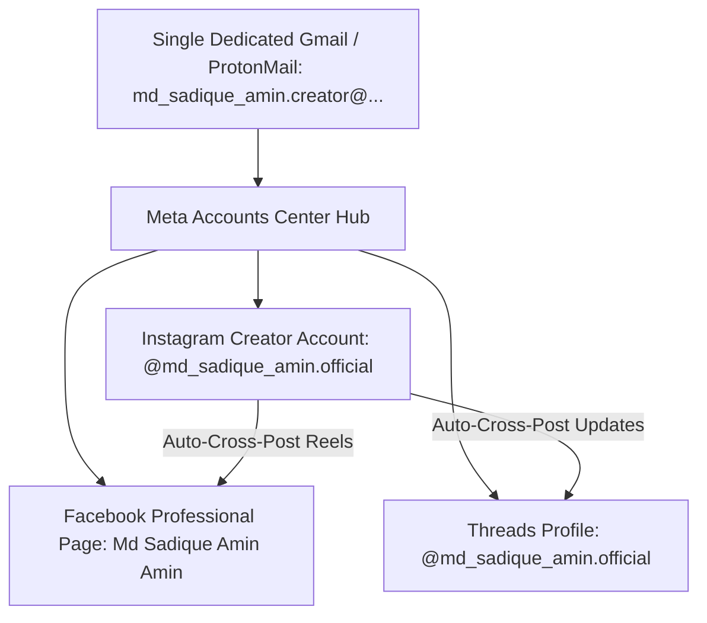

# Cross-Platform Meta Automation & Account Strategy
**Document Type:** Platform Operational Architecture & Anti-Ban Protocol  
**Target Platforms:** Instagram (Creator) + Facebook Page + Threads (Meta Ecosystem)  
**Authentication Standard:** Single Primary Email $\rightarrow$ Meta Accounts Center Federation  
**Target Identity:** `@md_sadique_amin.official` / `Md Sadique Amin Amin`

---

## 1. Single-Email Meta Accounts Center Architecture

Meta provides an integrated unified ecosystem where a single clean email address authenticates and interconnects all three primary platforms:



### Architecture Advantages:
1. **Zero Multi-Login Overhead:** Creating an Instagram Creator account automatically enables single-click generation of the linked Facebook Page and Threads profile.
2. **Native Cross-Posting (Zero API Penalty):**
   - In Instagram Settings $\rightarrow$ *Sharing Across Profiles*: Enable **"Share your Instagram posts and Reels to Facebook"**.
   - Whenever an asset is published to Instagram (via mobile automation or API), Meta's internal server automatically publishes it to the Facebook Page and Threads with zero additional bandwidth and zero bot detection triggers.

---

## 2. Account Creation & Warm-Up Protocol (Anti-Ban Guard)

*Fresh accounts that immediately publish automated content every 2 hours are flagged as bots by Meta's AI within 48 hours. Follow this strict 14-day humanization schedule:*

```
[DAYS 1 - 3: SEEDING & TRUST]
• Create account manually on OPPO A78 5G (using mobile 5G IP, not rotating proxies).
• Add bio: "Digital Creator & Visual Artist | Mumbai 📍 | Living life in aesthetic frames ✨".
• Upload profile picture (Md Sadique Amin Master Headshot from Character Bible).
• Browse Reels manually for 10-15 minutes; follow 10 verified photography/creator accounts.
• ZERO automated posts.

[DAYS 4 - 7: GENTLE CADENCE]
• Post 1 image every 24 hours with thoughtful, engaging captions (2-3 relevant hashtags).
• Add 1-2 Instagram Stories daily with interactive stickers (polls, questions).
• Engage with comments (like and reply to at least 3-5 users).

[DAYS 8 - 14: PROGRESSION]
• Begin automated posting via ADB/Termux at 1 post every 6 hours (4 posts/day max).
• Monitor account health status (Settings ➔ Account Status: ensure green checkmarks).

[DAY 15+: FULL 2-3 HOUR AUTOMATION CYCLE]
• Scale to autonomous 2-3 hour publishing cadence with randomized delay jitter (±15 mins).
```

---

## 3. Autonomous Publishing Methods: ADB vs Official Graph API

| Feature | Option A: Meta Graph API (Official) | Option B: ADB UI Automation (Mobile Node) |
| :--- | :--- | :--- |
| **Mechanism** | HTTP POST to `graph.facebook.com/v19.0` | Python pushes media to phone, triggers Instagram Share intent |
| **Safety Score** | 100% Safe (Official API route) | 95% Safe (Mimics human tap actions) |
| **Requirements** | Facebook Developer App + Instagram Business token | Connected OPPO A78 5G via ADB + Termux |
| **Asset Support** | Reels, Carousels, Single Images | All formats, Stories, Reels, Audio overlay |
| **Recommendation** | **Primary:** Meta Graph API for scheduled Posts<br>**Secondary:** ADB automation for native mobile app features |

---

## 4. Viral Hashtag & Description Engineering

To maximize Reach, Engagement, and Algorithm Indexing on Meta platforms:

### A. The 3-Tier Hashtag Architecture
Every post includes 9–15 curated hashtags categorized into three distinct tiers:
1. **Broad Niche (30%):** `#DigitalCreator #VisualStorytelling #IndianAesthetic #MumbaiLife`
2. **Community / Micro (40%):** `#ModestFashionIndia #DesiVibes #ChikankariLove #EthnicGrace`
3. **Trending / Topic-Specific (30%):** Dynamically harvested from the Google Trends / Twitter engine (e.g., `#MonsoonVibes #TechTrends2026`).

### B. Caption Formula for Retention
* **Line 1 (Hook):** One captivating question or bold statement ("Kya aapne kabhi socha hai...?").
* **Body (Value/Story):** 2–3 sentences reflecting Md Sadique Amin's warm personality and creative perspective.
* **Call to Action (CTA):** "Aapka ispar kya khayal hai? Comment me zaroor batayein 🌸".
