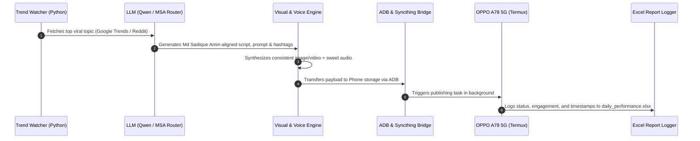

# Project 'Md Sadique Amin' — Master Virtual Creator & Autonomous Content Engine
**Classification:** Autonomous Multi-Agent AI Content Pipeline (Local + Mobile Architecture)  
**Target Hardware:** Windows Host (AMD Radeon Graphics, 16GB RAM) + Android Target (OPPO A78 5G via ADB & Termux)  
**Persona Codename:** `md_sadique_amin`  

---

## 1. Executive Engineering Summary

| Dimension | Specification | Architecture Solution |
| :--- | :--- | :--- |
| **Identity / Persona** | Female Virtual Creator ("Md Sadique Amin") | Fixed 512D ArcFace facial embedding + Trained LoRA + Rigorous Character Bible |
| **Aesthetic Consistency** | 100% feature lock (1 to 100,000+ assets) | PuLID / IP-Adapter + ControlNet DWPose + 1024px FaceDetailer inpainting pass |
| **Vocal Profile** | Sweet, natural Indian female voice | Edge-TTS Neural (`hi-IN-SwaraNeural` / `en-IN-NeerjaNeural`) + RVC v2 Timbre Anchor |
| **Trend Harvester** | Real-time viral topic detection | Zero-cost Google Trends RSS + Reddit JSON API + Wikipedia trending spikes |
| **Generation Cadence** | Every 2–3 hours automated cycle | Python scheduler background loop with jitter & exponential retry |
| **Dual-Node Bridge** | Laptop $\leftrightarrow$ OPPO A78 5G (Android 15) | Active ADB daemon channel + Termux worker daemon (`WS9X6LLJXW7H7TFQ`) |
| **Performance Audit** | 24-Hour continuous records | Dynamic Excel (`reports/daily_performance.xlsx`) + SQLite ledger |

---

## 2. Character Bible: Md Sadique Amin (`character/bible.yaml`)

```yaml
identity:
  name: "Md Sadique Amin"
  age: 22
  gender: "Female"
  ethnicity: "South Asian (Indian)"
  city: "Mumbai, Maharashtra (Bandra / South Mumbai lifestyle)"
  family_unit: "Mom, Dad, and Md Sadique Amin"
  education: "Graduate in Visual Communication & Digital Media"
  vocation: "Digital Creator, Creative Technologist & Visual Storyteller"
  hobbies: ["Photography", "Specialty Coffee", "Badminton", "Architecture", "Books"]

biometrics:
  height: "5 ft 6 in (168 cm)"
  physique: "Naturally athletic-slender, balanced natural proportions, graceful posture"
  complexion:
    tone: "Warm glowing fair/wheatish (#E8D0B8)"
    melanin_profile: "Natural subsurface scattering, subtle golden undertone"
    texture: "High-definition micro-pores, natural skin specular highlight, non-doll/non-plastic"
  face:
    shape: "Soft oval with defined jawline and gentle chin"
    eyes: "Almond-shaped, deep hazel-brown iris, delicate dark limbal rings, natural lashes"
    nose: "Naturally sculpted straight bridge with soft refined tip"
    lips: "Naturally plump, soft rose-pink vermilion border, gentle hydrated sheen"
    hair: "Rich dark espresso brown, soft natural beach waves, shoulder-to-mid-back length"
    distinguishing_marks: "A tiny delicate beauty mark (mole) 1.5 cm below left cheekbone"

wardrobe_dna:
  modest_traditional:
    - "Pastel silk sarees with subtle zari borders and boat-neck blouses"
    - "Lucknowi Chikankari long kurtas with palazzos and matching dupattas"
    - "Minimalist silver jewelry, subtle oxidized jhumkas, elegant watch"
  contemporary_chic:
    - "High-neck ribbed knit tops with high-waisted tailored linen trousers"
    - "Oversized cotton shirts over tank tops, modest structured blazers"
    - "Clean monochrome palette: cream, sage green, terracotta, warm ivory, navy"

voice_profile:
  character: "Warm, gentle, articulate, soothing, and sweet"
  timbre: "Melodious mid-range female vocal frequency (210 Hz – 240 Hz mean fundamental)"
  delivery: "Paced, conversational, expressive with natural breaths and subtle laughter pauses"
```

---

## 3. Technology Stack & Free/Open-Source Ecosystem

### A. Visual Identity Lock (How 1 to 100,000+ Assets Stay Identical)
```
[User Reference Photos] ──> [InsightFace / ArcFace] ──> [512-Dim Identity Vector]
                                                               │
                                                               ▼
[Text Prompt + Scene] ──> [Diffusion Model] <── [PuLID / IP-Adapter Cross-Attention]
                                │
                                ▼
                       [ControlNet DWPose] (Locks hands, spine & proportions)
                                │
                                ▼
                       [FaceDetailer / CodeFormer] (Ultra-HD 1024px facial finish)
```

1. **Latent Identity Embedding (PuLID / ArcFace):** Extracts mathematical facial geometry vectors so that no matter the prompt, clothing, or background, the face structure remains constant.
2. **Pose Integrity (ControlNet DWPose):** Enforces anatomically natural limbs, hands, and shoulders to eliminate common AI distortion.
3. **FaceDetailer (Inpainting):** Crops and re-synthesizes facial features at native high resolution, preserving the distinct beauty mark and iris patterns.

### B. Hardware-Aware Inference Strategy
Because your laptop runs **AMD Radeon Integrated Graphics (16 GB RAM)**:
* **Text / Scripting / Routing:** 100% Local via Ollama (`qwen2.5:7b-instruct`) and MSA Router (`127.0.0.1:20130`).
* **Voice Generation:** 100% Local via Edge-TTS / Kokoro / Piper (<100ms latency, zero GPU demand).
* **Image & Video Rendering:** Hybrid API bridging (Pollinations.ai / Hugging Face Inference / Gemini Flash Cloud Bridge) to produce $2K / 4K$ assets in seconds without overloading system RAM.

---

## 4. Automation Flow (2–3 Hour Cadence)



---

## 5. Directory Blueprint

```
d:\current using file\1 social media automation handler file/
├── config/
│   ├── settings.json               # Configurations, timing & API endpoints
│   └── categories.json             # 12 Content pillars
├── character/
│   ├── bible.yaml                  # Master Md Sadique Amin biometric specs
│   ├── prompts.yaml                # Master prompt templates
│   └── references/                 # Source reference frames
├── engines/
│   ├── trend_collector.py          # Google Trends & Reddit parser
│   ├── prompt_generator.py         # LLM script & caption synthesizer
│   ├── visual_engine.py            # Image synthesis & consistency pipeline
│   ├── voice_engine.py             # Sweet neural vocal generator
│   └── video_engine.py             # Facial animation & reel renderer
├── mobile/
│   ├── adb_controller.py           # PC-side ADB bridge for OPPO A78 5G
│   └── termux_daemon.sh            # Termux background sync worker
├── reports/
│   ├── excel_logger.py             # 24-hour XLSX auditing engine
│   └── daily_performance.xlsx      # Live dynamic Excel ledger
└── run_factory.py                  # Master autonomous 2-3 hour orchestrator
```
