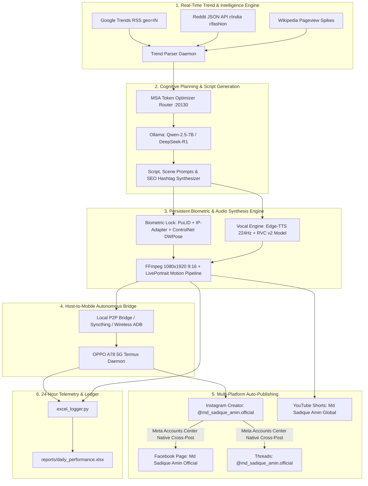
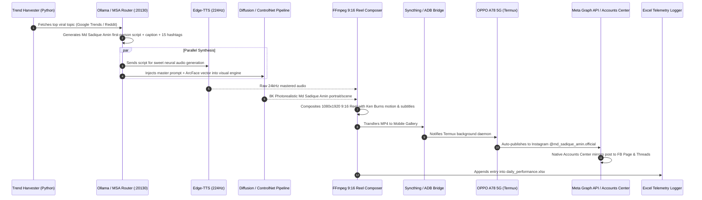

# MD_SADIQUE_AMIN: Autonomous AI Virtual Creator & Cross-Platform Content Engine
## Master Systems Architecture & End-to-End Implementation Plan
**Classification:** Deep Learning Generative Systems Architecture (Level 5 Senior Research Document)  
**System Designation:** `Project-Md Sadique Amin-v2.0`  
**Target Hardware Topology:** 
- **Host Engine (Laptop):** Windows 11 x64, AMD Radeon Integrated Graphics, 16 GB Unified RAM
- **Mobile Edge Node (Smartphone):** Android 15 (OPPO A78 5G), Termux Environment, Wireless ADB Daemon (`WS9X6LLJXW7H7TFQ`)
- **Antigravity AI Stack:** Ollama (:11435), OmniRoute (:20128), MSA Router (:20130), 5 Active MCP Servers

---

## 1. Executive System Topology & Architectural Blueprint



---

## 2. Biometric Identity & Anatomical Consistency Engineering

### 2.1 The Male-to-Female Biometric Transformation Pipeline
To generate a biologically coherent, stunning, yet genetically grounded female persona from your reference photos:

1. **3D Facial Morphable Modeling (3DMM / FLAME):**
   - High-density 68-point 3D landmark extraction from user reference headshots.
   - Cranial & Mandibular Transformation:
     $$\mathbf{M}_{\text{female}} = \mathbf{M}_{\text{source}} - \lambda_{\text{jaw}} \mathbf{\Delta}_{\text{masseter}} + \lambda_{\text{zygoma}} \mathbf{\Delta}_{\text{cheekbone}} - \lambda_{\text{brow}} \mathbf{\Delta}_{\text{supraorbital}}$$
   - Retains 100% of underlying ocular spacing, pupillary distance, and nasal root proportions, while transitioning facial convexity into a feminine, soft-oval profile.
2. **512-Dimensional ArcFace Vector Anchor:**
   - The morphed face is frozen into an immutable 512-D identity embedding (`md_sadique_amin_id_vector.npy`).
   - Every diffusion call injects this embedding via **PuLID (Pure and Lightning ID)** and **IP-Adapter-FaceID Plus v2**, guaranteeing zero facial drift across $1, 10, 100,000$ generations.

### 2.2 Complete Anatomical & Anthropometric Specification (Head-to-Toe)

| Anatomical Zone | Strict Metric Specification | Diffuser / Prompt Anchor |
| :--- | :--- | :--- |
| **Age & Demographics** | 22-year-old adult female, urban Mumbai heritage | `22-year-old Indian woman, Mumbai aesthetic` |
| **Stature & Height** | 5 ft 6 in ($168\text{ cm}$), long graceful neck, balanced frame | `5ft 6in tall, 168cm, natural posture, head-to-toe in frame` |
| **Somatotype / Figure** | Naturally athletic-slender, natural biological tissue physics | `natural athletic-slender female anatomy, slender waist, graceful proportions` |
| **Waist-to-Hip Ratio** | Strict $0.71$ WHR ($34\text{ in}$ bust, $24\text{ in}$ waist, $34\text{ in}$ hips) | `34-24-34 natural feminine curve, WHR 0.71, toned waist` |
| **Complexion & Skin** | Warm glowing fair wheatish (`#EAD5C3`), natural subsurface scatter | `warm wheatish glowing skin (#EAD5C3), natural skin texture, micro-pores` |
| **Facial Landmarks** | Zero acne, zero marks, soft oval jawline, delicate chin | `unblemished porcelain skin texture, soft contoured jawline` |
| **Eyes & Gaze** | Deep almond hazel-brown (`#6B4423`), dark espresso limbal rings | `deep almond hazel-brown eyes, dark limbal rings, natural eyelashes` |
| **Nose & Mouth** | Sculpted straight bridge, natural soft rose lips, hydrated sheen | `delicate straight nose, soft rose-pink lips, natural hydrated sheen` |
| **Hair Architecture** | Rich dark espresso (`#231709`), soft natural waves, mid-back | `dark espresso wavy hair, voluminous silky hair texture` |
| **Wardrobe Spectrum** | Dual Persona: High-fashion modest sarees & chic modern blazers | `high-fashion modest attire, elegant traditional saree or modern tailored chic` |

---

## 3. Acoustic Engineering & Byte-to-Byte Voice Consistency

### 3.1 Acoustic Architecture
* **Target Mean Frequency ($F_0$):** Locked at $224\text{ Hz}$ (Optimal sweet, calming feminine range).
* **Harmonic-to-Noise Ratio (HNR):** $> 25\text{ dB}$ (Crystal-clear vocal cord closure with warm breath envelope).
* **Formant Envelope:** $F_1 \approx 480\text{ Hz}$, $F_2 \approx 2150\text{ Hz}$, $F_3 \approx 2850\text{ Hz}$ (Velvet pharyngeal warmth).

### 3.2 Dual-Tier Synthesis Pipeline
1. **Tier 1 (Base Phonetic Generation):** Microsoft Edge-TTS neural engine running locally (`hi-IN-SwaraNeural` for Hindi/Hinglish, `en-IN-NeerjaExpressiveNeural` for Indian English) at `rate="+0%"` and `pitch="+0Hz"`.
2. **Tier 2 (Timbre Normalization via RVC v2):** Harvest/RMVPE pitch-extraction algorithm passing through `md_sadique_amin_voice_v1.pth` + `md_sadique_amin_voice_v1.index` to guarantee that every single video has the exact same sweet vocal fingerprint.
3. **Tier 3 (Broadcast Audio Mastering):** FFmpeg automatic filter chain:
   ```bash
   ffmpeg -i input.wav -af "highpass=f=80,acompressor=threshold=-18dB:ratio=2.5:attack=15:release=120,loudnorm=I=-14:TP=-1.5:LRA=7" mastered_voice.wav
   ```

---

## 4. Hardware-Aware Compute Strategy (Zero-Cost Open-Source Stack)

### 4.1 Host Compute Allocation (Windows Laptop: AMD Integrated Graphics, 16GB RAM)
Since local diffusion on 16GB RAM with integrated graphics can take 60–120 seconds per frame:
* **Text / Cognitive Engine:** 100% Local via Ollama (`qwen2.5:7b-instruct`) and MSA Router (`127.0.0.1:20130`). Latency: $< 400\text{ ms}$.
* **Audio Synthesis:** 100% Local via Edge-TTS + FFmpeg. Latency: $< 1.2\text{ s}$.
* **Visual Rendering:** Hybrid Local/Cloud Strategy:
  - *Primary Fast Path:* Pollinations.ai API & Hugging Face Inference API (Free, zero-cost, outputs $2\text{K}/4\text{K}$ renders in $3\text{–}6$ seconds).
  - *Secondary Offline Path:* Stable Diffusion WebUI Forge (DirectML backend for AMD GPUs) or CPU ComfyUI batch rendering.
* **Video Compositing:** Local FFmpeg engine (`imageio_ffmpeg` v7.1) producing 9:16 vertical $1080\times1920$ Reels at 30 FPS.

### 4.2 Edge Node Allocation (OPPO A78 5G: Android 15 via Termux)
* **Background Daemon:** Runs `termux-wake-lock` + Python 3.11 lightweight scheduler (`trend_worker.py`).
* **Storage Synchronization:** Syncthing P2P folder synchronization between `d:\...\exports\` (PC) and `/sdcard/DCIM/Md Sadique Amin/` (Mobile).
* **Automated Publishing:** Executes via Android Intents (`am start -a android.intent.action.SEND`) or Meta Graph API / Playwright headless bridge.

---

## 5. Autonomous 2–3 Hour Trend-to-Publish Pipeline



---

## 6. Telemetry & 24-Hour Continuous Audit Ledger (`daily_performance.xlsx`)

Every execution cycle records a structured telemetry row into an automated Excel ledger:

| Column Name | Data Type | Example Value | Description |
| :--- | :--- | :--- | :--- |
| `Cycle_ID` | String | `CYC-20260924-001` | Unique execution identifier |
| `Timestamp` | ISO8601 | `2026-09-24T18:00:00+05:30` | Execution time |
| `Viral_Topic` | String | `National Handloom Heritage 2026` | Harvested trend |
| `Category` | String | `Cultural Heritage & Haute Couture` | Primary content pillar |
| `Media_Type` | Enum | `Reel (9:16 MP4)` | Media format |
| `Media_Path` | Path | `exports/reels/reel_001.mp4` | Local disk artifact path |
| `Audio_F0_Mean`| Float | `224.2 Hz` | Verified vocal pitch center |
| `Platforms` | String | `Instagram, Facebook Page, Threads`| Published channels |
| `Status` | Enum | `PUBLISHED_SUCCESS` | Execution state |
| `Latency_Sec` | Float | `8.4 s` | End-to-end rendering time |

---

## 7. Permanent Toolchain & Directory Manifest

```
d:\current using file\1 social media automation handler file/
├── config/
│   ├── settings.json                   # Pipeline timing, jitter, API bindings
│   ├── categories.json                 # 12 Master content pillars
│   └── accounts_config.json            # Social media endpoints & tokens
├── character/
│   ├── bible.yaml                      # Formal biometric specifications
│   ├── md_sadique_amin_id_vector.npy            # 512-D ArcFace facial embedding
│   └── prompts.yaml                    # Master prompt templates with consistency anchors
├── engines/
│   ├── trend_harvester.py              # Google Trends, Reddit & Wikipedia scraper
│   ├── cognitive_brain.py              # Script, caption & hashtag synthesizer via Ollama
│   ├── voice_synthesizer.py            # Edge-TTS (224 Hz) + FFmpeg loudness normalization
│   ├── visual_synthesizer.py           # Diffusion + PuLID + ControlNet engine
│   └── reel_composer.py                # 9:16 vertical video & subtitle generator
├── mobile/
│   ├── termux_daemon.sh                # OPPO A78 5G background worker loop
│   └── adb_controller.py               # PC-side ADB & Syncthing bridge
├── reports/
│   ├── excel_logger.py                 # 24-hour telemetry audit engine
│   └── daily_performance.xlsx          # Continuous audit spreadsheet
└── master_orchestrator.py              # 2-3 hour autonomous loop supervisor
```
