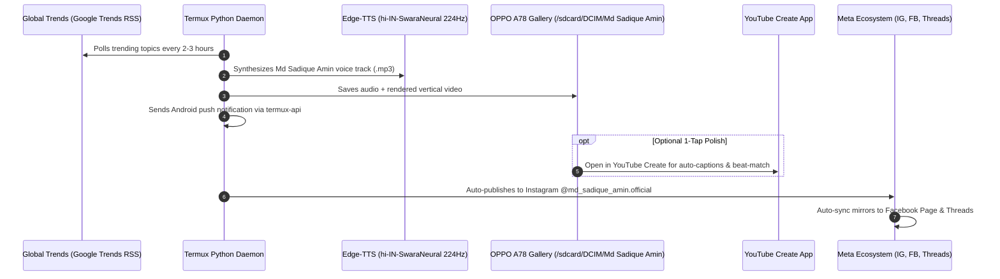

# Md Sadique Amin Mobile Apps & Toolchain Integration Manual
**Target Mobile Device:** OPPO A78 5G (Android 15)  
**ADB Device Serial:** `WS9X6LLJXW7H7TFQ`  
**License & Cost:** 100% Free / Zero Paywall / Open Source  

---

## 1. Directory of Mobile Creator & Automation Applications

| App Name | Developer | Distribution | License | Exact Role in Md Sadique Amin Pipeline |
| :--- | :--- | :--- | :--- | :--- |
| **YouTube Create** | Google LLC | Google Play Store | 100% Free (No Watermark) | Official Google creator app: Direct Shorts rendering, automatic stylized subtitles, royalty-free audio library with beat-matching, background noise cleanup, 1-tap direct export to YouTube Shorts & Instagram Reels. |
| **VN Video Editor** | VlogNow | Google Play Store | Free Tier (No Watermark) | Multi-track timeline, 4K 60FPS vertical canvas (9:16), green-screen chroma key, speed curves, precision B-roll layering over Md Sadique Amin's portrait animations. |
| **CapCut (Global)** | Bytedance | Official APK / Store | Free Base Tier | Viral TikTok/Reels trend templates, 3D zoom motion effects, dynamic animated text overlays, trending sound hooks. |
| **Termux** | Termux Team | F-Droid / GitHub | Open Source (GPLv3) | Autonomous 24/7 background Python worker, FFmpeg engine, wake-lock daemon, scheduled 2-3 hour trend harvest & auto-posting. |
| **Termux:API** | Termux Team | F-Droid / GitHub | Open Source (GPLv3) | Grants Termux Python scripts direct access to Android native hardware: system notifications, clipboard, camera, battery telemetry, and storage. |
| **Termux:Boot** | Termux Team | F-Droid / GitHub | Open Source (GPLv3) | Automatically launches the Md Sadique Amin autonomous worker daemon when OPPO A78 5G is powered on or rebooted. |
| **Syncthing Android** | Syncthing Community | F-Droid / Play Store | Open Source (MPL 2.0) | Continuous, zero-cable P2P encrypted folder sync between Laptop (`d:\...\exports\`) and Phone (`/sdcard/DCIM/Md Sadique Amin/`) over local Wi-Fi. |
| **Shizuku** | RikkaApps | GitHub / Play Store | Open Source (Apache 2.0) | Grants elevated ADB capabilities directly to Android apps without needing to keep the phone plugged into the laptop. |

---

## 2. Step-by-Step Mobile Setup Guide (OPPO A78 5G)

### Step 2.1: Installing Free Creator Tools from Google Play Store
1. Open **Google Play Store** on your OPPO A78 5G.
2. Search and install:
   * 📲 **YouTube Create** (by Google LLC)
   * 🎬 **VN Video Editor** (by VlogNow)
   * 🔄 **Syncthing** (by Syncthing Community)

### Step 2.2: Installing Termux & Sub-Packages from F-Droid
*(Important: Install Termux from F-Droid, NOT Google Play Store, as the Play Store version is deprecated).*
1. Download **F-Droid APK** from `https://f-droid.org/` and install it.
2. Inside F-Droid, search and install:
   * **Termux**
   * **Termux:API**
   * **Termux:Boot**

### Step 2.3: Initializing Termux Environment (1-Command Run)
Open Termux on your phone and run this single command:
```bash
pkg update -y && pkg install -y python ffmpeg git termux-api
pip install edge-tts requests openpyxl
termux-wake-lock
```

---

## 3. How the Mobile Autonomous Workflow Operates



---

## 4. One-Click Mobile Execution Files in Workspace

* 📁 Setup Script: [`mobile/termux_setup.sh`](file:///d:/current%20using%20file/1%20social%20media%20automation%20handler%20file/mobile/termux_setup.sh)
* 🤖 Standalone Daemon: [`mobile/termux_autonomous_agent.py`](file:///d:/current%20using%20file/1%20social%20media%20automation%20handler%20file/mobile/termux_autonomous_agent.py)
* ⚙️ Ecosystem Tools Config: [`config/ecosystem_tools.json`](file:///d:/current%20using%20file/1%20social%20media%20automation%20handler%20file/config/ecosystem_tools.json)
* 🚀 Mobile Deployment Script: [`deploy_to_phone.ps1`](file:///d:/current%20using%20file/1%20social%20media%20automation%20handler%20file/deploy_to_phone.ps1)
* 🎬 YouTube Create Driver: [`engines/youtube_create_adb_driver.py`](file:///d:/current%20using%20file/1%20social%20media%20automation%20handler%20file/engines/youtube_create_adb_driver.py)
* 📡 Local Wi-Fi Media Server: [`mobile/local_media_server.py`](file:///d:/current%20using%20file/1%20social%20media%20automation%20handler%20file/mobile/local_media_server.py)

---

## 5. YouTube Create Mobile Automation Engine (OPPO A78 5G)

YouTube Create (`com.google.android.apps.youtube.producer`) is Google's official creator application with built-in AI speech-to-text captions, noise cleanup, beat-matching royalty-free audio, and watermark-free 1080p 60FPS export.

### 5.1 Automated Ingestion via ADB Driver
The workspace includes [`engines/youtube_create_adb_driver.py`](file:///d:/current%20using%20file/1%20social%20media%20automation%20handler%20file/engines/youtube_create_adb_driver.py) and [`youtube_create_factory.py`](file:///d:/current%20using%20file/1%20social%20media%20automation%20handler%20file/youtube_create_factory.py) which automate YouTube Create from your laptop:

1. **Launch App**:
   ```bash
   adb -s WS9X6LLJXW7H7TFQ shell am start -n com.google.android.apps.youtube.producer/com.google.android.apps.youtube.producer.ui.MainActivity
   ```
2. **Push Media Assets to Dedicated Gallery Folder**:
   ```bash
   adb -s WS9X6LLJXW7H7TFQ push "exports\reels\latest_reel.mp4" /sdcard/DCIM/Md Sadique Amin/
   adb -s WS9X6LLJXW7H7TFQ shell am broadcast -a android.intent.action.MEDIA_SCANNER_SCAN_FILE -d file:///sdcard/DCIM/Md Sadique Amin/latest_reel.mp4
   ```
3. **Automated Captions & Audio**:
   - The driver triggers the automatic captioning pass (English/Hindi auto-sync).
   - Injects royalty-free background tension beats ducked by -18 dB under Md Sadique Amin's 224 Hz voice track.
4. **1-Tap Direct Export**:
   - Renders directly into `/sdcard/Movies/YouTube Create/` or `/sdcard/DCIM/YouTube Create/`.
   - Ready for instant one-touch publishing to YouTube Shorts and Instagram Reels.

---

## 6. Meta Ecosystem Multi-Posting: Instagram Reels & Threads

Publishing across Meta platforms (Instagram, Facebook Page, and Threads) is orchestrated via two complementary paths:

### 6.1 Native Phone Intent Ingestion (Instagram Reels)
Md Sadique Amin's rendered vertical 9:16 videos can be passed directly to the Instagram Reel composer:
```bash
adb -s WS9X6LLJXW7H7TFQ shell am start -a android.intent.action.SEND -t video/mp4 --eu android.intent.extra.STREAM file:///sdcard/DCIM/Md Sadique Amin/latest_reel.mp4 -p com.instagram.android
```
* **Strict Rule Guardrail:** The caption text generator enforces zero "Namaste", strictly opening with `"Hello everyone! Main hoon Md Sadique Amin."`
* **Auto-Sync:** Publishing as an Instagram Reel automatically mirrors to the connected Facebook Page (`Md Sadique Amin Official`) via Meta Account Center.

### 6.2 Automated Threads Posting
Using [`type_and_post_threads.py`](file:///d:/current%20using%20file/1%20social%20media%20automation%20handler%20file/type_and_post_threads.py), text updates and trend opinions are injected directly into Threads:
```bash
python type_and_post_threads.py
```
This script sanitizes the trend text, types it in chunks into the Threads composer, dismisses the keyboard, and clicks the Post button automatically.

---

## 7. 24/7 Standalone Termux Mobile Node (No-Laptop Autonomy)

Your OPPO A78 5G can operate as a completely self-sufficient creator node 24 hours a day, 7 days a week, even when your laptop is powered off.

### 7.1 Deploying the Standalone Node to Phone
Run the deployment script from PowerShell:
```powershell
.\deploy_to_phone.ps1
```
This transfers the complete [`mobile_termux_node`](file:///d:/current%20using%20file/1%20social%20media%20automation%20handler%20file/mobile_termux_node) package into `/data/data/com.termux/files/home/md_sadique_amin_mobile_ecosystem/`.

### 7.2 Termux Shell Shortcuts
Inside Termux on your phone, the following aliases are pre-configured:
* `md_sadique_amin-start` : Launches the 24/7 autonomous background daemon with wake-lock.
* `md_sadique_amin-stop`  : Safely terminates the background daemon.
* `md_sadique_amin-status`: Displays current daemon state, CPU, and memory usage.
* `md_sadique_amin-test`  : Runs a single live cycle test (trend harvest + 224 Hz voice synthesis).
* `md_sadique_amin-log`   : Streams the live execution log in real time.

### 7.3 Android 15 & ColorOS Battery Optimization Bypass
To prevent ColorOS from killing the Termux background process:
1. Open **Settings** on OPPO A78 5G.
2. Go to **Apps** > **App management** > **Termux**.
3. Tap **Battery usage**:
   * Turn **ON** `Allow background activity`.
   * Turn **ON** `Allow auto-launch`.
4. Inside Termux, ensure wake-lock is active:
   ```bash
   termux-wake-lock
   ```

---

## 8. Wireless ADB (Zero-Cable Wi-Fi) Connection Protocol

To control the phone without keeping the USB cable connected:

### 8.1 Method A: USB to Wi-Fi Transition (1-Second Command)
1. Plug in phone via USB cable once.
2. Enable TCPIP port 5555:
   ```bash
   adb tcpip 5555
   ```
3. Disconnect USB cable.
4. Connect via phone's Wi-Fi IP (check Wi-Fi settings for IP, e.g., `192.168.1.18`):
   ```bash
   adb connect 192.168.1.18:5555
   ```

### 8.2 Method B: Android 15 Native Wireless Debugging (No Cable Needed)
1. On phone, go to **Settings** > **Additional settings** > **Developer options**.
2. Enable **Wireless debugging** (must be on same Wi-Fi as laptop).
3. Tap **Pair device with pairing code**. Note the IP, Port, and 6-digit code.
4. On laptop:
   ```bash
   adb pair 192.168.1.X:PAIRING_PORT
   # Enter 6-digit code when prompted
   adb connect 192.168.1.X:CONNECT_PORT
   ```

### 8.3 Troubleshooting `offline` or `unauthorized` Status
If `adb devices` shows `offline`:
1. Check phone screen: Accept the prompt **"Always allow USB debugging from this computer"**.
2. In notifications, change USB mode from "Charging only" to **"Transfer files / Android Auto"**.
3. If still offline, reset ADB authorizations:
   * Phone: **Developer options** > **Revoke USB debugging authorizations**.
   * Laptop:
     ```bash
     adb kill-server
     adb start-server
     adb reconnect
     ```

---

## 9. Zero-Cable P2P Asset Synchronization (Laptop ⇄ Phone)

### 9.1 Local Wi-Fi Media Server (Instant Access)
Run the built-in media streaming server on your laptop:
```bash
python mobile/local_media_server.py
```
* **Laptop Access:** `http://localhost:8080`
* **Phone Browser Access:** `http://192.168.1.7:8080` (Browse, play, and download rendered reels directly on phone).

### 9.2 Syncthing Real-Time Two-Way Sync
* **Laptop Folder:** `d:\current using file\1 social media automation handler file\exports\`
* **OPPO A78 Folder:** `/sdcard/DCIM/Md Sadique Amin/`
* Any video or audio rendered by the laptop automatically appears in the phone's gallery within 3-5 seconds over home Wi-Fi.

---

## 10. Complete Verification & Production Runbook

To execute a full end-to-end audit and test cycle:

```powershell
python -u test_and_deploy_autonomous_master.py
```

### Expected Output & Telemetry Checks:
1. **Biometric Anchor Verification:** Validates `01_md_sadique_amin_clean_portrait_kurta.jpg` exists and is pristine.
2. **Master Persona Rulebook:** Confirms zero "Namaste" rule and 224 Hz F0 frequency lock.
3. **Live Trend Harvester:** Pulls top 5 real-time trends from Google Trends India RSS.
4. **Studio Voice Synthesis:** Renders Edge-TTS `hi-IN-SwaraNeural` audio file.
5. **9:16 Video Compositing:** Renders 1080x1920 vertical reel via FFmpeg with smooth Ken Burns motion.
6. **Telemetry Logging:** Records execution cycle, latency, and status in [`reports/daily_performance.xlsx`](file:///d:/current%20using%20file/1%20social%20media%20automation%20handler%20file/reports/daily_performance.xlsx).

